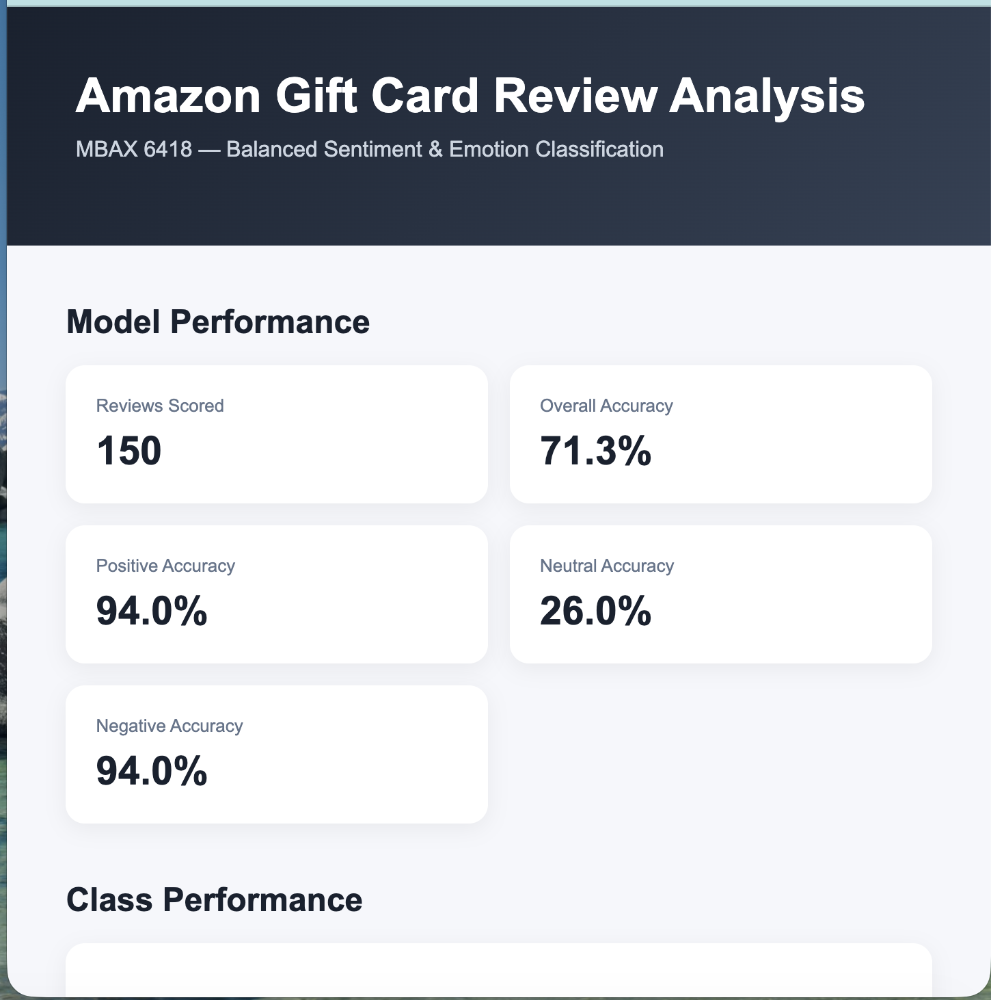

# MBAX 6418 Assignment 1
## Amazon Gift Card Sentiment and Emotion Analysis

### Project Overview

This project evaluates the ability of a large language model (LLM) to classify sentiment and primary emotion in Amazon Gift Card reviews. The analysis uses the Amazon Reviews '23 Gift Cards dataset from the McAuley Lab at UC San Diego.

The model receives only the review title and review text. Star ratings are withheld from the model and are used afterward as reference labels for evaluating sentiment predictions.

## Dataset

Dataset: Amazon Reviews '23  
Category: Gift Cards  
Source: McAuley Lab, UC San Diego  

https://amazon-reviews-2023.github.io

## Initial Binary Sentiment Analysis

The initial analysis used the first 100 reviews.

Sentiment labels were defined as:

- 4–5 stars = POSITIVE
- 1–3 stars = NEGATIVE

Results:

- Reviews analyzed: 100
- Correct predictions: 97
- Mismatches: 3
- Overall accuracy: 97.0%

Although the initial accuracy appeared very strong, the first 100 reviews were not a balanced representation of the sentiment classes. Because high-star reviews dominated the sample, overall accuracy alone provided an incomplete picture of model performance.

## Balanced Three-Class Evaluation

The final evaluation used three sentiment classes:

- 4–5 stars = POSITIVE
- 3 stars = NEUTRAL
- 1–2 stars = NEGATIVE

A reproducible balanced sample of 150 reviews was created using 50 reviews from each class.

### Balanced Results

- Overall accuracy: 71.3%
- POSITIVE accuracy: 94.0%
- NEUTRAL accuracy: 26.0%
- NEGATIVE accuracy: 94.0%

### Confusion Matrix

| Actual / Predicted | NEGATIVE | NEUTRAL | POSITIVE |
|---|---:|---:|---:|
| NEGATIVE | 47 | 2 | 1 |
| NEUTRAL | 29 | 13 | 8 |
| POSITIVE | 0 | 3 | 47 |

## What Changed After Balanced Sampling?

Balanced sampling revealed weaknesses that were difficult to see in the original 100-review analysis. The model continued to perform strongly on clearly positive and clearly negative reviews, achieving 94% accuracy for both classes. However, its accuracy on neutral reviews fell to only 26%.

Of the 50 actual neutral reviews, only 13 were correctly classified as neutral. Twenty-nine were classified as negative and eight were classified as positive. This shows that three-star reviews were much more difficult for the model to classify correctly than clearly positive or clearly negative reviews.

The decrease from 97.0% initial accuracy to 71.3% balanced accuracy demonstrates why class balance and class-level performance are important when evaluating a classification model.

## Primary Emotion Analysis

Two independent methods were used to identify the primary emotion of each review:

1. LLM primary-emotion classification
2. NRC emotion word-list scoring

The eight emotions used were:

- anger
- anticipation
- disgust
- fear
- joy
- sadness
- surprise
- trust

### Emotion Agreement

The LLM and NRC emotion methods had an agreement rate of 0.0% across the 150 balanced reviews. This indicates that the two approaches did not select the same primary emotion for any of the reviews in the final dataset. The result highlights a substantial difference between contextual LLM-based emotion classification and lexicon-based NRC scoring. The LLM interprets the overall meaning and context of a review, while NRC relies on associations between individual words and predefined emotions. This difference in methodology may contribute to the lack of agreement observed in this analysis.

The two approaches can disagree because they analyze emotion differently. The LLM considers the overall context and meaning of the review, while the NRC method scores individual words according to their emotion associations. A review may therefore contain emotion-related words that do not fully represent the overall meaning of the review.

## Dashboard

The final HTML dashboard includes:

- Overall balanced accuracy
- Accuracy by sentiment class
- Star-rating distribution
- Actual versus predicted class counts
- Confusion matrix
- LLM versus NRC emotion comparison
- Review-level results
- Interactive filtering for all reviews, correct predictions, and mismatches

## Development Challenges

Several technical issues occurred during development. The original Python environment did not contain the required pandas and OpenAI packages, so a dedicated virtual environment was created and selected in VS Code.

File paths also caused problems when the dashboard attempted to locate saved CSV output files. Absolute file paths were used during development to make sure the scripts loaded the correct results.

CSS and HTML code was accidentally placed directly inside the Python scoring script at one point, producing a Python syntax error. Separating the scoring, emotion-analysis, and dashboard code resolved the problem.

The project was also organized so completed LLM classifications did not need to be rerun unnecessarily.

## Reproducibility

The balanced evaluation used a fixed random seed so the same sample could be reproduced.

The LLM does not receive the star rating when making its prediction. Ratings are used only after prediction to create the reference sentiment label and evaluate model performance.

## Files

- `Assignment1_MBAX6418.py` — initial sentiment classification and scoring
- `emotion_analysis.py` — emotion analysis and comparison
- `Dashboard.py` — final dashboard generator
- `dashboard.html` — final interactive dashboard
- `step5_final_results.csv` — saved balanced results
- `prompt.txt` — structured classification prompt
- `requirements.txt` — Python dependencies
- `.gitignore` — files excluded from GitHub
- `screenshots/final_dashboard.png` — dashboard screenshot
